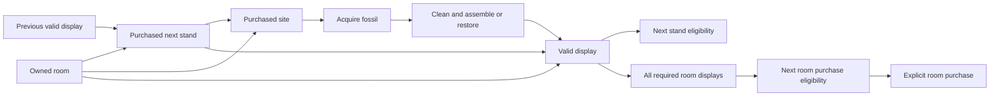

# Phase 7.6A — Permian fossil and excavation-site dependency graph

Implemented 11 November 2026. This increment defines and verifies **future progression only**. It adds no playable fossils, travel destinations, purchase commands, geometry, prices, helper behavior or save fields. Schema 24, the live west wing and the existing three playable exhibits remain unchanged. All work is uncommitted.

The approved graph has a deterministic **80-node acyclic witness** covering **17 stands, eight sites, 17 acquisitions, 17 restorations, 17 displays, three owned rooms and one repeatable-income source**. A separate synthetic walkthrough exercises the actual pure queries and the Phase 7.4B display predicate, buying seven sites and two later rooms once each. Room 1 and Site 1 start available. These results establish planned dependency reachability, not physical or playable availability of the 14 future exhibits.

## Changed files and boundaries

| File | Change |
| --- | --- |
| [Future progression content](../../src/content/permian-progression.ts) | New authoritative global order, stand mappings, eight site definitions, typed graph and exhibit-to-site lookup. |
| [Future difficulty content](../../src/content/permian-difficulty.ts) | New independent candidate material/coefficient groups, metadata validation and zero-based layer lookup. |
| [Pure queries](../../src/game/permian-progression.ts) | New eligibility/status queries over explicit ownership and existing display evidence. |
| [Graph validator](../../src/game/permian-progression-validation.ts) | New structural checks, mixed dependency cycle detection, symbolic reachability and conservative bootstrap analysis. |
| [New tests](../../tests/permian-progression.test.ts) | 102 deterministic tests for definitions, queries, negative configurations, reachability, difficulty and live/save isolation. |
| [Existing room tests](../../tests/permian-rooms.test.ts) | Extend the planning-module import allowlist for these isolated consumers; existing Phase 7.4B behavior assertions remain unchanged. |
| [Decision log](../decisions.md) | Append approved order, assignments, two-layer grouping and cross-museum helper principles. |
| This document | Contract, evidence, integration boundaries and independent review. |

The existing `permian-museum.ts` membership and featured metadata, `permian-rooms.ts` display predicate, all live catalogs and all persistence contracts were left unchanged. The workspace already had unrelated uncommitted changes; these were retained. No dependencies, package commands or historical simulation artifacts were changed.

## Authoritative exhibit and stand sequence

`PERMIAN_EXHIBIT_ORDER` defines purchase progression. Room membership remains in its existing metadata order; it is not repurposed as a purchase-order array. Stand IDs are `stand-<exhibit-id>`, preserving `stand-dimetrodon`, `stand-trilobite` and `stand-eryops` exactly. Exhibit IDs are reused from the existing Permian catalog; no alternative identities or future anatomical recipes are introduced.

| Position | Exhibit ID | Size | Room | Excavation site |
| --- | --- | --- | --- | --- |
| 1 | `dimetrodon` | Large | `permian-room-1` | `courtyard-dig` |
| 2 | `trilobite` | Small | `permian-room-1` | `courtyard-dig` |
| 3 | `eryops` | Large | `permian-room-1` | `eryops-dig` |
| 4 | `walchia` | Small | `permian-room-1` | `eryops-dig` |
| 5 | `moschops` | Large | `permian-room-2` | `moschops-dig` |
| 6 | `arthropleura` | Small | `permian-room-2` | `moschops-dig` |
| 7 | `estemmenosuchus` | Large | `permian-room-2` | `estemmenosuchus-dig` |
| 8 | `glossopteris` | Small | `permian-room-2` | `estemmenosuchus-dig` |
| 9 | `edaphosaurus` | Large | `permian-room-2` | `edaphosaurus-dig` |
| 10 | `captorhinus` | Small | `permian-room-2` | `edaphosaurus-dig` |
| 11 | `gorgonops` | Large | `permian-room-3` | `gorgonops-dig` |
| 12 | `helicoprion` | Small | `permian-room-3` | `gorgonops-dig` |
| 13 | `scutosaurus` | Large | `permian-room-3` | `scutosaurus-dig` |
| 14 | `gorgonops-tooth` | Small | `permian-room-3` | `scutosaurus-dig` |
| 15 | `inostrancevia` | Large | `permian-room-3` | `inostrancevia-dig` |
| 16 | `dicynodon` | Small | `permian-room-3` | `inostrancevia-dig` |
| 17 | `permian-ammonoid` | Small | `permian-room-3` | `inostrancevia-dig` |

The featured exhibits remain **Eryops / Moschops / Inostrancevia**. All four Room 1 exhibits are required before Room 2 purchase eligibility; all six Room 2 exhibits are required before Room 3 eligibility. Completion never purchases a room. After the room is purchased, Moschops or Gorgonops can become the next stand offer, respectively. All seven Room 3 exhibits are required to complete the museum.

## Eight sites and their purchase gates

| Site | Stable ID | Trigger stand | Fossils | Room | Provisional cost |
| --- | --- | --- | --- | --- | --- |
| 1 | `courtyard-dig` | `stand-dimetrodon`, descriptive only: initial access bypasses purchase | Dimetrodon, trilobite | 1 | 0 |
| 2 | `eryops-dig` | `stand-eryops` | Eryops, Walchia | 1 | 20 |
| 3 | `moschops-dig` | `stand-moschops` | Moschops, Arthropleura | 2 | 30 |
| 4 | `estemmenosuchus-dig` | `stand-estemmenosuchus` | Estemmenosuchus, Glossopteris | 2 | 40 |
| 5 | `edaphosaurus-dig` | `stand-edaphosaurus` | Edaphosaurus, Captorhinus | 2 | 50 |
| 6 | `gorgonops-dig` | `stand-gorgonops` | Gorgonops, Helicoprion | 3 | 60 |
| 7 | `scutosaurus-dig` | `stand-scutosaurus` | Scutosaurus, Gorgonops tooth | 3 | 75 |
| 8 | `inostrancevia-dig` | `stand-inostrancevia` | Inostrancevia, Dicynodon, Permian ammonoid | 3 | 90 |

The first two IDs match existing active identities. Sites 3–8 use descriptive IDs based on their triggering specimen. The existing `future-site-03` live placeholder is not an authored matching site and is deliberately left untouched; it is not an alias for `moschops-dig`.

Only `courtyard-dig` is initially available, without stand purchase or ticket revenue. Every later site requires the purchased triggering stand and its owned room. The triggering stand is always the first exhibit from that site in the global sequence, so buying it does not require any of that site's fossils to have already been displayed. Site eligibility never creates site ownership.

An owned site stays accessible after earlier displays become absent, provided its room ownership remains valid. The same site purchase covers all its assigned fossils, including early finds whose stands are not yet eligible. Acquiring/restoring those finds cannot replace a purchased stand or skip the next required display. Sites do not gain a `completed` status from these queries: display completion is not proof that a pit is exhausted or closed.

`requiredSiteIds` is an explicit diagnostic field with empty lists in every approved site. This version rejects nonempty lists, including otherwise acyclic additions, because predecessor-site purchase/closure gates were not approved. Injected self/two-site cycles can consequently be diagnosed rather than silently ignored. There is no new production site dependency API.

The latest approval changes the [v2.1 simulation](7-economy-digging-v2.1-simulation.md): Inostrancevia is now at Site 8, not Site 7, and its stand precedes site-purchase eligibility. The simulation used synthetic site-before-stand access and recommended a different ordering policy. Its files/results remain historical and reproducible; their duration and financial numbers are not presented as reruns of this approved graph. A later balancing rerun should consume the new plan explicitly.

## Pure query contract

```ts
type PermianProgressionState = {
  readonly ownedRoomIds: readonly PermianRoomId[];
  readonly ownedStandIds: readonly string[];
  readonly purchasedSiteIds: readonly PermianSiteId[];
  readonly exhibits: readonly PermianExhibitProgress[];
};
```

These inputs are projections of **authoritatively validated entitlements**, not receipts or new saved state. Room 1 must be included by the caller's ownership projection. Later room ownership must also include predecessor rooms. Removing a predecessor's display does not remove its ownership, but a later room claimed without its ancestor rooms is contradictory input and fails closed.

`PermianProgressDefinitions` is the existing Phase 7.4B input: required part IDs per exhibit, plus authoritative stand ID/exhibit/room assignments. No required-part definitions for planned fossils are shipped here. Tests use the actual three live recipes and clearly named synthetic restored tokens for the other 14. Future integration must supply actual approved recipes; a missing/ambiguous/empty recipe blocks a new stand offer.

| API | Result and meaning |
| --- | --- |
| `nextPermianExhibit(state, definitions)` | Earliest exhibit lacking a valid display, even if its room or stand is locked. `undefined` means all 17 displays validate. |
| `eligiblePermianStand(state, definitions)` | The single next stand plan, or `undefined`. Requires the current next exhibit, owned room, valid definitions and an unowned stand. Returns a copy rather than a purchase or grant. |
| `permianStandStatus(standId, state, definitions)` | `locked`, `eligible-for-purchase`, `available` for a valid owned stand, or `completed` for its valid display. Unknown ID returns `undefined`. |
| `permianSiteStatus(siteId, state, definitions)` | `locked`, `eligible-for-purchase` or `available`; unknown ID returns `undefined`. No synthetic exhaustion/closure status. |
| `permianProgressionRoomStatus(roomId, state, definitions)` | `locked`, `eligible-for-purchase`, `available` or `completed`; unknown ID returns `undefined`. |
| `siteForPermianExhibit(exhibitId)` | Its single designated future site definition; unknown exhibit returns `undefined`. |
| `validatePermianProgressionGraph(graph?, budget?)` | Structural issues, compiled nodes, ordered reachability witness, reachable IDs by stage and conditional financial conclusion. |
| `permianLayerCandidate(plan, layerIndex)` | Validated candidate material, resistance and coefficient for a zero-based layer; invalid metadata/index returns `undefined`. |

The query functions use the approved catalog. Injected graph definitions are accepted by the validator for authoring/testing, not as runtime overrides for those queries. These are typed TypeScript APIs, not raw JSON parsers; callers must not pass arbitrary malformed object shapes.

### Valid display and ownership evidence

The new queries project only stands whose IDs, exhibit assignments and rooms match the future stand catalog, and only exhibit records whose acquisition site is initially available or explicitly purchased in an owned room. They then call **`isPermianExhibitDisplayed` from Phase 7.4B**. Required parts, actual placement, matching owned stands and duplicate/ambiguous display records are validated by that single existing predicate; its logic is not reimplemented.

`nextPermianExhibit` scans from the beginning, so a later valid-looking record never skips an earlier gap. For example, a restored trilobite, an arbitrary `completedExhibitIds` hint and a supplied Eryops stand cannot make Eryops's site eligible before the Dimetrodon/trilobite display prefix is complete. New site eligibility checks that full prefix in addition to the triggering stand. Once a site has a validated purchase entitlement, current display removal does not revoke it.

Stand ownership is checked separately from eligibility. A valid owned empty stand is `available` even though it is no longer an offer, and it prevents the next offer until its fossil is displayed. A matching owned stand ID is not proof of payment: the caller must derive it from validated receipts. The pure API cannot distinguish a forged but internally consistent ownership projection from legitimate saved history. It does not authenticate transactions or invent grants to repair invalid states.

Unknown IDs, wrong stand definitions, locked/missing rooms, absent acquisition-site ownership and invalid display evidence cannot grant progress. Duplicate ownership IDs do not create extra eligibility or extra site purchases. Duplicate exhibit progress/recipe/stand-definition records remain invalid under the Phase 7.4B rules. Queries are read-only and tested on deeply frozen inputs, so rejection cannot create a partial grant. Actual purchase rejection/atomicity will belong to future transaction commands, none of which are added here.

## Graph model and validation algorithm

The ordinary paid-site chain is:



For the first exhibit, Room 1 and the free site are roots; Dimetrodon's stand needs no previous display. Eligibility and an explicit synthetic purchase are separate in the query walkthrough. The validator's `room`, `stand` and `site` nodes represent the entitlement after that hypothetical purchase, not an automatic grant at eligibility.

Validation proceeds as follows:

1. **Catalog integrity:** verify unique exhibit/room/stand/site IDs; exactly the approved 17 exhibits, three rooms and eight stable sites; exactly one room, stand and site per exhibit; nonempty sites; preserved sizes, membership and featured metadata. Reuse `validatePermianRoomDependencies` for predecessor cycles and required-display membership failures.
2. **Approved order and gates:** sort the sequence by explicit position; require every integer position 1–17 once, the exact approved exhibit at that position and its correct stand. Each stand requires exactly the preceding exhibit's display, except the first. Each site must retain its approved assignment, room and trigger. Room predecessor/initial flags and complete required-exhibit sets must remain exact. Changing prices does not change ordering.
3. **Compile prerequisites:** create room-ownership, stand-ownership, site-access, acquisition, restoration, display and income nodes. A later room requires its predecessor room and all that predecessor's required displays. Acquisition requires the designated site; restoration requires acquisition; display requires restoration and the correct owned stand/room. A later paid entitlement requires the symbolic repeatable-income source. Site 1 bypasses its descriptive trigger because it is free and initially available.
4. **Detect unknown edges and cycles:** DFS tracks the active path and reports the complete circular prerequisite path. It catches mixed cycles such as site → Walchia stand → Eryops display → acquisition at that same site, not merely cycles within a single array. Self/two-site, stand/self-display and room predecessor cycles are all exercised.
5. **Construct a witness:** monotone closure repeatedly adds nodes whose prerequisites are reached. The first stand is additionally blocked if bootstrap funds do not cover its cost. Unreached nodes report their unmet prerequisites. Stable catalog order makes the witness deterministic. Each site entitlement is represented once regardless of its fossil count.

Errors include a machine-readable `code`, affected `path`, and an actionable message. For example, a site trigger referring to its own later fossil produces both an assignment-contract error and a circular path naming the stand, display, acquisition and site involved. Missing room completion requirements report `room-completion-gate`; a successor room starting owned reports `room-order`.

An invalid configuration can still have some reachable nodes, which are useful diagnostics. **Only `valid: true` certifies the approved planned graph.** A reachable count alone does not waive structural/order errors. The validator does not create real anatomy, geometry, content, purchases or saved progress.

### Conservative financial analysis

Defaults are 20 starting coins and a 12-coin first stand. With a free initial site and assumed free acquisition/restoration, **eight coins remain and Dimetrodon's first paying display is reachable without prior ticket revenue, soil luck, historical credit, optional workers or upgrades**.

Every subsequent mandatory entitlement has a path after the repeatable-income node. Site candidate prices must be finite nonnegative integers. Future stand/room price sequences deliberately remain outside this dependency graph. The result labels later affordability **`conditional`**, assuming finite prices, eventual visitor payment/manual collection, no additional mandatory acquisition/restoration charges and no recurring drains. It does not calculate tickets, waiting time or acceptable pacing. A test raises a later candidate site price to 999,999 and confirms that the structural path still exists; that is explicitly not a balance endorsement.

The financial input can vary starting coins/first-stand cost to test bootstrap failures. Insufficient, negative or nonfinite amounts fail validation and block the first income node. There are no helper/upgrade nodes, so neither can be a hidden mandatory dependency. Active ticket pricing, live costs and schema-24 credit remain untouched.

## Reachability evidence

| Check | Result |
| --- | --- |
| Compiled nodes / reached nodes | 80 / 80 |
| Stand entitlements | 17 |
| Site access nodes | 8, including one initially free site |
| Acquisition / restoration / display nodes | 17 / 17 / 17 |
| Owned rooms | 3, including initially owned Room 1 |
| Symbolic income sources | 1, after valid first display |
| Dependency/structural issues | 0 for approved graph |
| Query walkthrough paid-site purchases | 7, no duplicates |
| Query walkthrough later-room purchases | 2, no automatic grants |
| Bootstrap spend / remainder | 12 / 8 coins |

Tests assert every position against an independent approval fixture, every site trigger and exact site assignment, the distinction between eligibility and purchase, room boundary behavior, invalid displays/ownership, frozen-input purity and the full walkthrough. Negative injections cover duplicate/unknown/missing identities, missing or ambiguous assignments, invalid sizes, duplicate/noninteger/out-of-order positions, removed stand prerequisites, all cycle categories, wrong-room gates, unreachable first display, paid first site, early Room 2/3 access, weakened completion gates and altered featured metadata.

The live catalogs still contain three playable exhibits, two playable sites and the existing nonplayable third placeholder. Live Site 2 remains 24 coins and the existing stands remain 12/8/12; the 18-coin west wing remains functional. Tests assert the existing 8×8 grids and 1/2 live layer counts. Future module consumers are explicitly allowlisted so the plan cannot silently enter application, travel or persistence code.

## Planned depth metadata

Difficulty is separate from progression validation: changing a material candidate cannot unlock a stand or site. Each site stores its own layer count and group array. The current candidates are:

| Sites | Candidate layers | Two-layer material/coefficient groups |
| --- | --- | --- |
| `courtyard-dig` | 1 | Loose soil, resistance 1, coefficient 1.00 |
| `eryops-dig` | 2 | Layers 1–2: loose soil / 1 / 1.00 |
| `moschops-dig`, `estemmenosuchus-dig` | 3 | Layers 1–2: loose / 1 / 1.00; layer 3: packed / 2 / 1.35 |
| `edaphosaurus-dig`, `gorgonops-dig` | 4 | Layers 1–2: loose / 1 / 1.00; layers 3–4: packed / 2 / 1.35 |
| `scutosaurus-dig`, `inostrancevia-dig` | 5 | Previous two groups, then layer 5: resistant / 3 / 1.70 |

Material IDs are `loose-soil`, `packed-soil` and `resistant-soil`, with resistance candidates 1/2/3. Group index is `floor(zeroBasedLayer / 2)`. Both material and coefficient change between adjacent groups; the final odd layer uses the next group. Coefficients must be finite and positive, layer counts integers 1–5, and group count exactly `ceil(layers / 2)`. Invalid or unknown materials and invalid layer indexes return no candidate. Per-site coefficients can differ; no universal compulsory curve is introduced.

The specific counts and 1.00/1.35/1.70 coefficients are reversible planning candidates, not balance approval. They intentionally follow the newly requested two-layer grouping rather than replaying the simulation's per-layer curves. No damage formula, hit count, tool power, material reward, live grid or excavation depth is changed. Five layers are the current candidate validation envelope, not an irreversible engine limit.

## Approved future helper ownership principle

Purchased digging helpers **persist across museums**, and their purchased upgrades persist with them. A player visit must activate each new site's work. After activation, workers may operate while the player is in the museum or another accessible location, provided the game simulation is actively running. Closing the application or pausing simulation stops work; there is no offline catch-up. Recovered parts remain in their original excavation site's chest until the player collects and transports them.

This is recorded architecture, not an implemented migration or behavior change. Existing helpers still follow their current same-pit behavior and existing custody/persistence contract. Cross-museum ownership, background clocks and site activation need their own durable transaction designs and tests before integration.

## Validation results and reproduction

The following checks passed with no failures or skipped tests:

| Check | Result |
| --- | --- |
| New Phase 7.6A cases | 102 passed |
| Phase 7.6A plus unchanged Phase 7.4B cases | 145 passed |
| Focused graph/room/ownership/credit suite | 264 passed |
| Full configured `npm test` | 590 passed |
| Standalone `npx tsc --noEmit` | Passed before the final ancestor guard; the final build reran TypeScript successfully |
| Final `npm run build` | TypeScript and Vite production build passed; existing >500 kB chunk warning remains |

```powershell
node --test --test-isolation=none tests/permian-progression.test.ts tests/permian-rooms.test.ts tests/room-ownership.test.ts tests/expansion-credit.test.ts
npm test
npm run build
```

Focused tests use Node's in-process test mode; the configured full suite/build use the environment's authorized subprocess execution. Schema-24 round trips are unchanged, and new room purchase receipts, new site ownership and future stand entitlements are still rejected by its existing validators. The full suite covers the historical compatibility and Phase 7.5A/7.5B behaviors alongside the earlier simulations.

No manual browser or visual check was run: this task changes no controls, UI or scene behavior. No real player saves were opened or modified. Actual future fossil collection, cleaning/assembly, collision-free travel, chest access, room geometry and child comprehension remain unverified until those features exist. All acceptance criteria for this bounded future-definition/pure-validation increment are met; live integration is intentionally unimplemented.

## INDEPENDENT CODEX REVIEW — FOR CHATGPT ANALYSIS

This is a critical Codex assessment of the bounded implementation, not a claim that a separate reviewer agent certified production gameplay.

1. **Low — order correctness, verified.** All 17 approved positions, sizes and room memberships are independently asserted. Global progression is separate from room presentation order. Stable IDs are reused; Inostrancevia is correctly assigned to Site 8. Later edits must keep the independent approval fixture current only when the product decision changes.
2. **High integration limitation — reachable sites.** All eight planned sites and 17 acquisition/restoration/display chains are symbolically reachable, and the synthetic query walkthrough completes. Real footprints, parts, recipes, cleaning interactions, travel routes and museum placement do not exist for the 14 planned exhibits. This is not a full playable reachability proof.
3. **Medium — sites before room ownership, verified fail-closed behavior.** New site eligibility requires its owned room, ancestor room ownership and correct purchased trigger, with the preceding global display prefix intact. Inconsistent room claims cannot make sites eligible. Already validated purchased-site access persists when displays are removed; ownership must still be authenticated by a future save/receipt adapter.
4. **Medium — out-of-sequence stands, verified.** Only the earliest missing valid display's stand can be offered, and an owned unfinished stand blocks its successor. Early finds and duplicate/invalid records cannot advance the sequence. A self-consistent fabricated receipt projection cannot be distinguished from genuine payment by a read-only query; callers must not treat raw ID arrays as authenticated ownership.
5. **High integration limitation — circular deadlocks.** The approved declared graph is acyclic. Tests reject room, stand/self-display, site/self and mixed acquisition cycles and report their paths. Undeclared future recipe, transport, equipment or geometry prerequisites are outside that proof. They must be represented and validated before adding playable content.
6. **Low — multiple fossils per site, verified.** One access node and one purchase projection cover all assigned fossils; the walkthrough purchases seven paid sites once. Site 8's three fossils do not create additional purchase requirements. This does not yet certify duplicate-action handling in a future durable purchase command.
7. **Critical activation gate — production and schema isolation.** No live modules import the new plan, and schema 24 still rejects future entitlements. Activating purchases under that schema by simply relaxing validation would bypass the frozen ownership/payment/credit contract. Define and test versioned transaction receipts before any live activation. No Critical current-scope defect was found; this is a concrete prerequisite to integration.
8. **Low — two-layer grouping, verified within its envelope.** Independent site counts and coefficients support the approved 1–5-layer candidate range; invalid/nonpositive values fail. It deliberately does not model mixed materials within one layer or 6+ layers. Such extensions need explicit metadata and test updates rather than changing current digging silently.
9. **High — unverified experience and financial timing.** The bootstrap proves only 12 of 20 coins are sufficient for the first stand, assuming the free acquisition/restoration path. Later finite purchases have a potential income path, but no acceptable waiting time, queue throughput, upgrade value or child comprehension is proved. The old economy simulation uses a different Site 7/8 assignment and purchase policy and must be rerun before using its figures for this graph.
10. **Medium — smallest safe next step.** Add a read-only development projection from validated current ownership and actual recipes into these queries for the existing content, with no live grants or gates. Show clearly when planned recipes are unavailable. Before implementing purchases, settle the versioned stand/site/room receipt and credit contract and test atomic failure/retry/duplicate handling. Then author one new fossil/site slice and replace its synthetic acquisition assumptions with real reachability checks.

No additional implementation or approval request is needed to complete Phase 7.6A. Production integration, new content and helper changes remain separate tasks. No commit, push, merge, rebase or history rewrite was performed.
