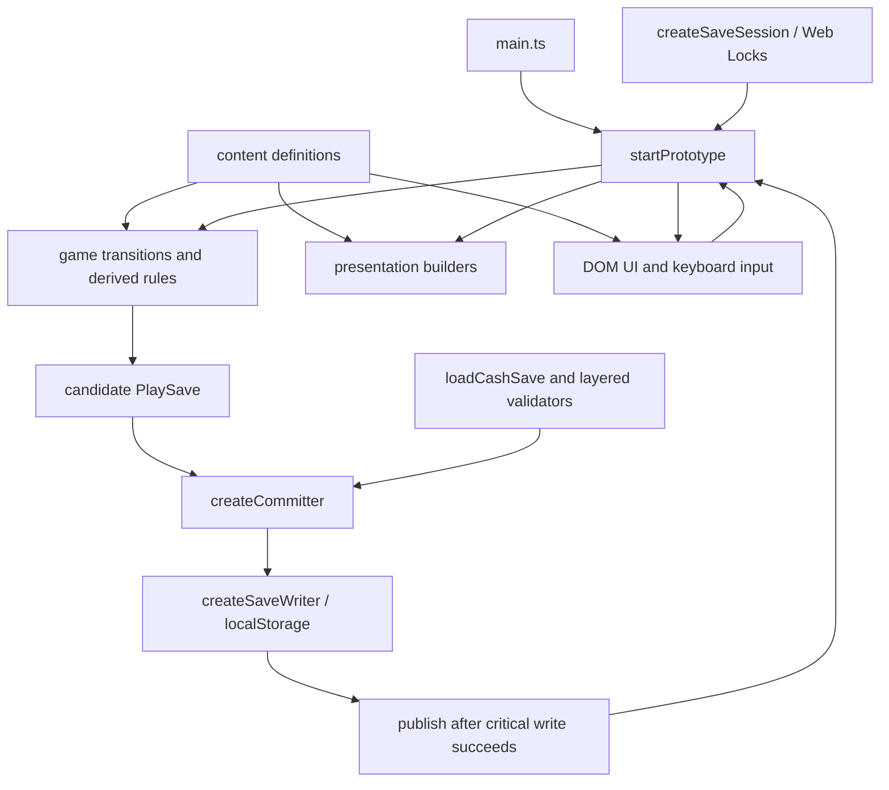

# Architecture and runtime data flow

Verified source audit, 2026-11-08. Paths are relative to the repository root.

## Responsibilities

`src/app/prototype.ts:startPrototype` owns mutable runtime variables: full `game: PlaySave`, projected `state: JourneyState`, player `position`, active panel, selected exhibit/purchase, cleaning selection, shovel/cleanup clocks, layout and simulation instances. There is no event bus or external state-store library.

The full current normal-play save is `CashSave` schema 21. `museumJourney()` and `economyOf()` project it into older sub-contracts for shared rules. `advanceMuseum()` merges a journey transition through the economy and restores ownership, location, visitor, helper, custody, upgrade, deposit and pending-cash fields. These explicit conversions are important coupling points for any new save field.

## Startup and shutdown

1. `src/main.ts` imports CSS and calls `startPrototype(#app)`; hot module replacement calls the returned disposer.
2. Startup chooses normal localStorage or a development QA slot from `?purchases=1` / `?helpers=1`. Helpers QA takes precedence if both are present. Both QA modes run the current full loop.
3. `createHud()` creates DOM and canvas. `createWorld(canvas, true, true)` creates the Babylon engine and initial scene; failure shows a localized error.
4. Keyboard, UI, visitor/helper/purchase simulations, committer and session are initialized. The seed-zero initial in-memory state is provisional.
5. The Web Locks session must become active before loading or mutating saved progress. `loadCashSave(storage, randomSeed())` validates/migrates existing state or creates a fresh game. The candidate is committed before `restore()` enables the playable result.
6. `restore()` resets transient simulations, derives museum layout, rebuilds the appropriate scene, chooses a safe spawn and refreshes UI. Exact player coordinates are not restored from storage.
7. Babylon's render loop calls `advanceSimulation()` and then refreshes UI, world actors, banknotes and projected labels.
8. Blur/visibility/page lifecycle handlers clear input and flush progress. `pagehide` settles interrupted deliveries and releases the writer; persisted-page restoration reacquires it. An external storage change blocks play pending reload.
9. Disposal flushes eligible pending state, removes listeners, disposes panels, scene/engine and session, then clears the root.

## Update and transaction ordering

`stepSimulation()` handles automatic site completion or player movement/travel/digging, then purchase contributions, exhibit interaction, visitors and helpers. Player work runs before helper work so a changed soil target invalidates stale helper progress.

`advanceSimulation()` clamps real delta to 0.05 seconds. Development speeds repeat the bounded step 1, 2, 5 or 10 times; they are not a persistent player upgrade. No offline elapsed-time catch-up is implemented.

- **Critical transitions:** shovel hits/rewards, collection, placement, purchases, ticket events, cash collection, travel and helper custody/task milestones use `committer.commit(candidate, publish)`.
- **Incremental checkpoints:** cleaning masks and ongoing helper work may publish in memory after scheduling a checkpoint. The writer flushes after at most one scheduled 1,000 ms interval and at lifecycle/activity boundaries.
- **Failure:** a critical candidate and its publish callback remain pending; mutations stop. Retry writes that exact candidate and publishes once. It does not rerun a purchase or reward command.

`createSaveSession` uses Web Locks; a localStorage flag is not used as a substitute. Unsupported/denied locking prevents an active writer. The storage adapter routes all persistence to the selected normal or QA key.

## Rendering architecture

`src/presentation/world.ts:createWorld` owns one main Babylon `Engine` and the active `Scene`. `buildRoom()` disposes the previous scene and generates museum, camp or pit geometry. A museum ownership-layout key change can rebuild the museum scene. Multiple museum rooms are not separate current scene types: `RoomId` is only `museum | outdoors | excavation`.

`shapes.ts` supplies procedural mesh helpers; `skeletons.ts:SKELETONS` selects Dimetrodon/Eryops builders and assembly anchors. `fossil-profiles.ts` supplies facet silhouettes shared by excavation and 2D cleaning/inventory artwork. The trilobite display has a dedicated `buildSlabExhibit`.

`createAssemblyPreview()` creates a **second Babylon engine and scene** for the close-up assembled-fossil canvas, reusing the skeleton recipe. It is shown/paused with the activity and disposed when switching skeleton recipes or disposing the UI. Whole-fossil placement uses the slab preview instead.

## Important dependencies and limitations

| System | Depends on |
| --- | --- |
| Ticket eligibility/price/arrival | Complete required parts + owned stand + available wing via `displayedExhibits()` |
| Placement | Collected discovery, correct part target, stand ownership, museum location |
| Excavation closure | Every assigned find exposed and collected, then soil cleanup and automatic exit |
| Paid second site | First-site closure + at least one complete display + currency |
| Expansion | At least one complete display + currency |
| Helper purchase | Two complete displays + second-site ownership + useful soil + currency |
| Save validation | Content IDs/layouts, exact receipt prices, total earnings/spending and layered historical contracts |

Separation is useful but incomplete: `prototype.ts` is the central coordinator; layout and some presentation/UI paths contain species-specific assumptions; schema 12–21 wrappers reuse validators whose supposedly historical checks still import live content. Additive content is therefore not automatically backward compatible.

Recommendation: retain pure transitions and the committer/session boundary. Generalize only the room/content/ledger assumptions needed for the next increment; avoid replacing the runtime with a new framework.
