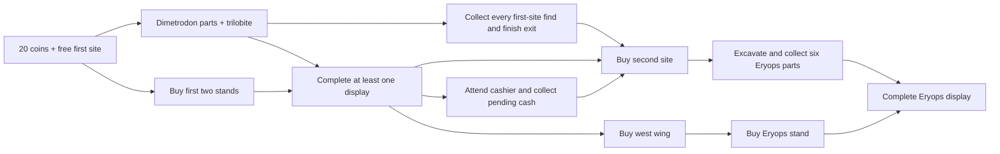

# Progression and unlocks

Verified current rules, 2026-11-08. The planned all-exhibits-in-previous-room rule is not implemented.

## Current gates

| Action | Requirements | Functions/state |
| --- | --- | --- |
| Enter first camp | Free starter site | `siteOwned`, `travelTo`; `world.location` |
| Enter a pit | Owned playable site, currently in its own camp, pit not closed, no cleanup/exit underway | `travelTo`, `travelBusy`; `closedSites` |
| Close first/second site | All assigned discoveries exposed, cleaned and explicitly collected; finish remaining soil cleanup and exit | `allSiteRecovered`, `completionPhase`, `stepCompletion` |
| Buy second site | First site closed, at least one complete displayed exhibit, 24 spendable coins, not busy | `sitePurchaseStatus`, `buySite` |
| Buy Dimetrodon or trilobite stand | In museum, offer unowned, enough remaining coins; partial contributions allowed with at least 1 coin | `purchaseStatus`, `contributePurchase` |
| Buy west wing | In museum, unowned, at least one complete display, 18 coins/retained contributions | Same |
| Buy Eryops stand | In museum, west wing owned, offer unowned, 12 coins/retained contributions | Same; **no excavation prerequisite** |
| Place a part | Matching collected/unplaced part and target; museum; stand owned; Eryops also needs west wing | `placeOwnedGroup`, `placeGroup`, `standAvailable` |
| Attract visitors | At least one complete owned display; museum simulation active | `displayedExhibits`, `canArrive` |
| Hire helper | Two complete displays, second-site ownership, useful unfinished work at an owned site, 60 coins, not busy, no existing available helper | `helperPurchaseStatus`, `buyHelper` |
| Buy boots | Museum, one complete display, unowned, 16 coins | `upgradeStatus` |
| Buy shovel | Museum, one complete display, useful remaining soil, unowned, 24 coins | `upgradeStatus`, `helperLayer` |
| Buy helper tools | Museum, owned helper, useful remaining soil, unowned, 30 coins | Same |

Rules are in `src/game/purchases.ts`, `world-map.ts`, `journey.ts`, `site-completion.ts`, `helpers.ts` and `upgrades.ts`. Definitions/prices are in matching `src/content/` modules. Application guards additionally block commands during save failure, conflicting writer, inappropriate activities and hidden/unfocused input.

## Recent pedestal prerequisite change

The November 7 batch removed first-site closure and second-site ownership as stand-purchase prerequisites. **All three stands can now be owned before the first site closes**, if the player has displayed the first-pit trilobite or Dimetrodon, earned/collected enough tickets and purchased the west wing. Eryops still needs that wing because its physical slot is there. The initial two stands do not require any complete exhibit.

`purchaseStatus()` and the current `parseMuseumSave()` / `parseTravelSave()` agree on this removal. `tests/phase6-batch1.test.ts` verifies early Eryops deposits/full purchase and reload with no first-site closure or second-site ownership. Buying a stand **does not unlock its excavation site**. Room/layout availability and excavation access are independent concepts, though current code still has a special Eryops wing condition.

## Physical expansion

`museum.owned` includes `west-wing`; `museumLayout()` uses it to change the floor from 16×12 to 25×12. The Eryops slot at X −11 becomes accessible. There is no separately saved “Room 2,” no third room, no `previousRoom.requiredExhibits.every(...)` condition, and no dim preview of unowned future rooms. Expansion requires **any one** complete display, not both current first-pit exhibits.

The offer is a purchase; eligibility does not automatically build the wing. Partial deposits and duplicate purchase guards apply. There is no stand-placement editor: purchase constructs the predefined slot for that exhibit.

## Progress relationships

All paid nodes also require spendable funds. Site closure is independent of assembly: the player can recover everything before buying stands, or place finds incrementally before finishing a pit. The trilobite can be the first display; Dimetrodon is not a mandatory first-completion gate.

## Goals, tutorial and ending

`game/assembly.ts:tutorialDismissed` derives permanent arrow dismissal from `placed.length > 0`, including one partial skeleton part. `ui/journey.ts:update` derives hints from current space, unplaced inventory, first-site closure and completion of every `EXHIBITS` entry. `prototype.ts` can override the museum hint with stand-purchase guidance while stands remain needed.

Hints still contain first-site/Eryops/slab-specific wording. They are not a general objective or quest graph. One wording limitation is that first-site closure selects the “second site is open” exploration text even though paid site ownership may still be missing; map eligibility remains authoritative.

After all three exhibits are placed, the UI displays the all-exhibits-complete message and invites walking/story viewing. No next museum, credits sequence, prestige/reset reward, respawning excavation or room-completion reward is implemented. Optional completed-state purchases remain subject to their normal conditions; shovel/helper-related purchases require useful work and become unavailable once all soil is exhausted. Tickets continue while the museum simulation is attended.

## Expansion recommendations

Define room membership and predecessor requirements explicitly, derive eligibility from completed available displays, and keep room payment separate from eligibility. Gate each stand by owned room only, preserving the recent independence from excavation progression. Keep room prices/site allocation as explicit future decisions. Regression tests must cover every permitted purchase order, partial deposits, incomplete previous-room displays, legacy wing ownership and zero-soil-income progression.
