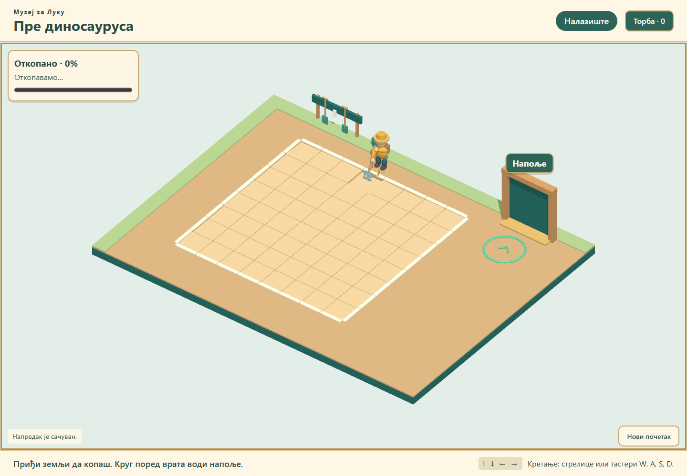
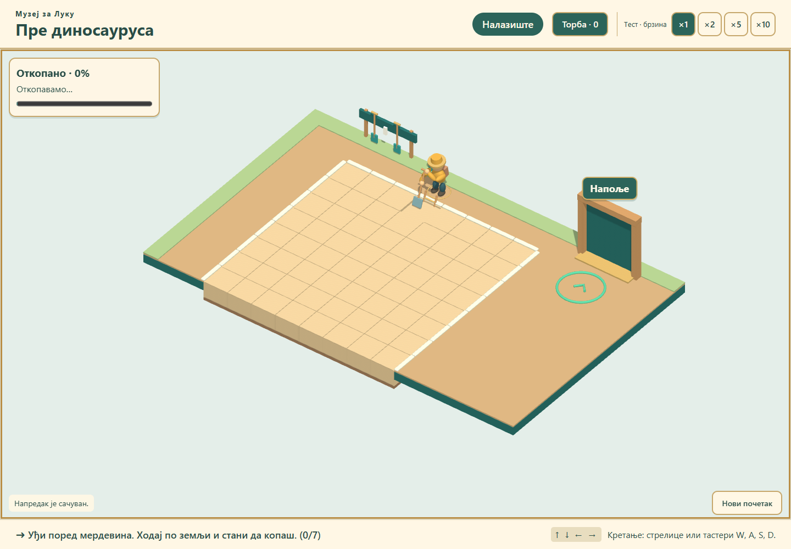
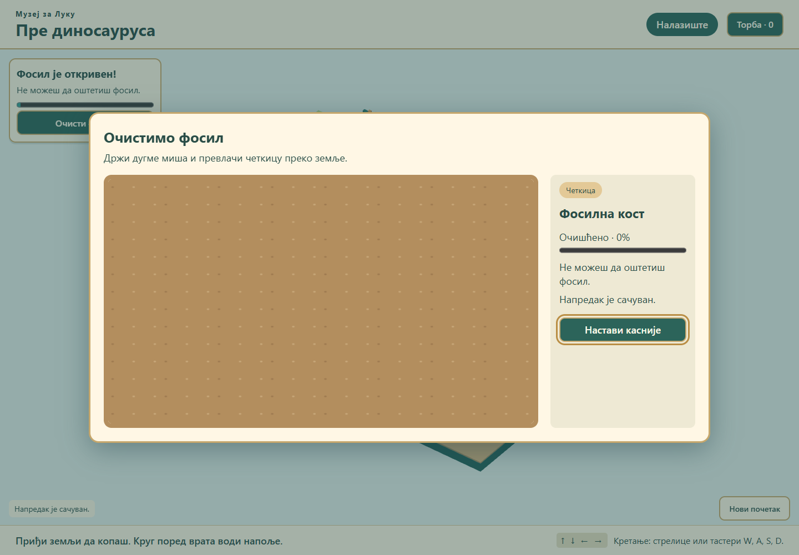
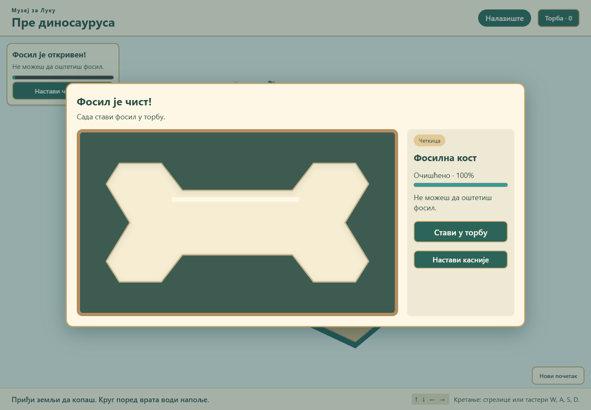

# Digging polish QA — 2026-10-07

Implemented and checked against the existing V2 style. [Changed files and current persistence contract](../digging-polish.md).

## Checks and results

- `npm test`: **32/32 pass**. Covers full-tray coverage and bounds, ready-but-uncollected reload, guarded/unique collection, previous-save conversion, contact/recovery timing, ground support at tile depths, soil walking, walls, ladder entry, sequential cleanup, exit, unique closure, storage failure/retry/reset.
- `npm run build`: **pass**. Existing Vite large-chunk advisory remains; no dependencies were added.
- `check-journey.mjs`: **pass**. Real input from museum to site; partial dig interruption/reload; automatic cleaning popup; corner dirt brushing; repeat strokes; dirty bag button disabled; ready popup stays open; ready state survives reload; double activation collects once; failed writes/retry; sequential cleanup and closure; bag, return, reset/cancel, invalid saves and unavailable storage. Canvas, bag button and close action fit all tested viewports. No browser errors.
- `check-digging.mjs`: **pass**. Frame-level blade contact with the pre-hit surface, visible lean, planted feet, no character translation, two hits with the same material, recovery before the next strike, depth rendering fixture, full-pit framing. Reviewed raised/contact screenshots.
- `check-completion.mjs`: **pass**. One pop and one removal at a time, visibly separated at the faster cadence; pause/reload; already-empty but uncollected site waits for brushing and bag activation; automatic ladder walk; exit reload; closure only at the front.
- `check-browser.mjs`: **pass**. Crossed all eight untouched soil rows while holding movement, stopped at the far wall, and verified no digging or sinking during that walk. Returned via the ladder and walked the perimeter. Existing museum furniture, travel, blur, arrival, camera and responsive-label checks also pass. The helper's back-path waypoints were shortened to prevent its eight-direction steering from drifting into the wall.

Microsoft Edge **154.0.4258.53**, headless Playwright with disposable profiles. Viewports: **1440×1000, 1280×720, 768×1024, 390×844**. Existing adjacent Playwright installation was used read-only; Luka's save/profile was not accessed. Visual review used the captured browser renders, not a hands-on child playtest.

Reproduction commands (start the configured Vite server first; substitute its URL):

```powershell
npm test
npm run build
node scripts/check-journey.mjs "F:/Milos/Repos/Muzej/node_modules/playwright/index.mjs" http://127.0.0.1:5184/
node scripts/check-digging.mjs "F:/Milos/Repos/Muzej/node_modules/playwright/index.mjs" http://127.0.0.1:5184/
node scripts/check-completion.mjs "F:/Milos/Repos/Muzej/node_modules/playwright/index.mjs" http://127.0.0.1:5184/
node scripts/check-browser.mjs "F:/Milos/Repos/Muzej/node_modules/playwright/index.mjs" http://127.0.0.1:5184/ docs/qa/polish-navigation
```

## Before and after

Same 1440×1000 viewport:

| Previous shovel | Bent elbows and hip lean at contact |
| --- | --- |
|  |  |

| Previous cleaning popup | Clean fossil awaiting the bag action |
| --- | --- |
|  |  |

- [Character standing on untouched soil after crossing the pit](polish-navigation-on-soil.png).
- [Raised shovel](polish-raised.png) and [second hit](polish-second-hit.png).
- [Disabled bag action at 1280×720](polish-cleaning-1280x720.png), [phone-sized popup](polish-cleaning-390x844.png), [portrait tablet](polish-cleaning-768x1024.png).
- [Sequential cleanup](polish-cleanup.png), [closed site](polish-closed.png).

## Remaining playtest limitations

Animation readability and the faster pace still need a short hands-on check with Luka. In a separate QA save, walk over soil, stop facing different directions, watch two strikes, brush the edges and middle of the tray, put the clean fossil in the bag, and watch cleanup/return. Later depths have rule/render fixtures; this slice still authors only one playable, one-layer site. No unrelated content, economy, or touch movement controls were introduced.
