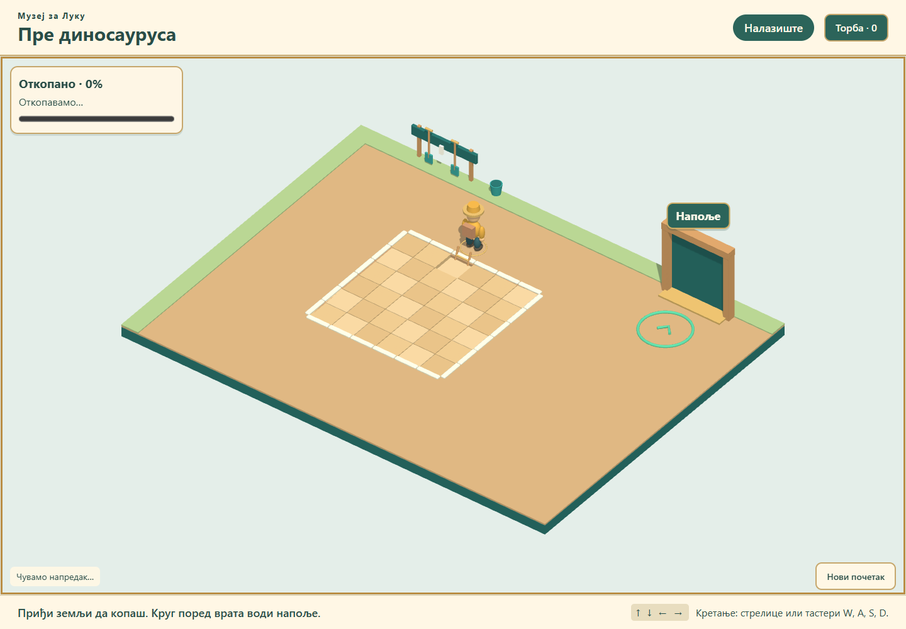
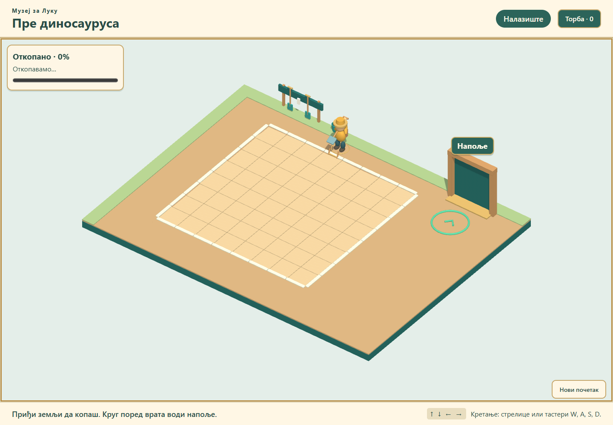

# Shovel digging QA — 2026-10-07

## Result

Passed the 8 × 8/two-hit shovel change with the existing V2 scene and cleaning flow. See [implementation, save contract, and changed files](../digging-shovel.md).

## Checks run

```text
npm test
npm run build
node scripts/check-digging.mjs F:/Milos/Repos/Muzej/node_modules/playwright/index.mjs http://127.0.0.1:5183/
node scripts/check-journey.mjs F:/Milos/Repos/Muzej/node_modules/playwright/index.mjs http://127.0.0.1:5183/
node scripts/check-browser.mjs F:/Milos/Repos/Muzej/node_modules/playwright/index.mjs http://127.0.0.1:5183/ docs/qa/digging-navigation
```

- Unit suite: **23/23 pass**. Includes two hits per layer, a three-layer rule fixture, contact-only commits, no time catch-up, interruption, exact partial save conversion, spatial cleaning, unique collection, navigation and protected recovery/reset.
- Production build: **pass**. Vite still reports its existing large-chunk advisory; no dependencies or bundling changes were introduced.
- Focused render check: **pass**. Captured windup and both contacts. Tile height stays unchanged until hit 1, remains at its first-hit height until hit 2, and retains the same material. Only the struck tile clears. An isolated two-layer rendering fixture verifies equal materials within each layer and a different material at the next depth. No second playable site was added.
- Complete journey: **pass**. Entered from the museum/outdoors through real keyboard input, retained a first hit across interruption/reload, automatically opened cleaning, preserved its mask after closing/reloading, completed collection exactly once, and stopped digging while the cleaning panel remained open. Then walked/stopped throughout all 64 tiles, with each remaining tile requiring normal shovel actions. Returned outdoors/museum, verified later-site eligibility, and exercised failure/retry, reset/cancel, corrupt saves, and denied storage access. No console/page errors.
- Navigation/layout: **pass**. Walked around all four sides of the larger pit, checked uncleared collision, exit/re-entry, safe arrivals, physical WASD input, blur clearing, responsive labels and unchanged camera framing. No console/page errors.

Browser: **Microsoft Edge 154.0.4258.53**, headless Playwright, disposable isolated contexts. QA used the existing adjacent Playwright installation read-only. Luka's browser profile/save was not accessed. Viewports: **1440 × 1000, 1280 × 720, 768 × 1024, 390 × 844**.

## Visual evidence and inspection

Before/after at the same 1440 × 1000 viewport:

| Before: 6 × 6, no active shovel | After: 8 × 8, larger tiles and shovel |
| --- | --- |
|  |  |

Additional reviewed captures:

- [First shovel contact](digging-first-hit.png), [second contact/cleared entry](digging-second-hit.png).
- [Digging after collecting the fossil](digging-continuing.png): readable cleared floor, remaining raised blocks, shovel, and preserved field equipment/exit.
- [Automatic cleaning popup](digging-auto-cleaning.png), [completed pit](digging-cleared.png).
- [Small portrait framing](digging-framing-390x844.png): the full pit stays visible without overlapping the status card, though individual objects are much smaller than on desktop.

The visual review used rendered screenshots at their captured scale, alongside real-input browser automation. It is not a claim of a hands-on Luka playtest.

## Remaining human QA

In a separate QA profile, enter the first site, watch two swings open the entry, walk through it toward the next block, clean the find, then keep excavating. Leave after one hit and reload; that hit should remain. Confirm the one-second swing cadence and shovel readability feel clear to Luka. First-site depth is deliberately one layer; future depths have fixture coverage but await authored playable sites. Touch controls remain outside this change.
