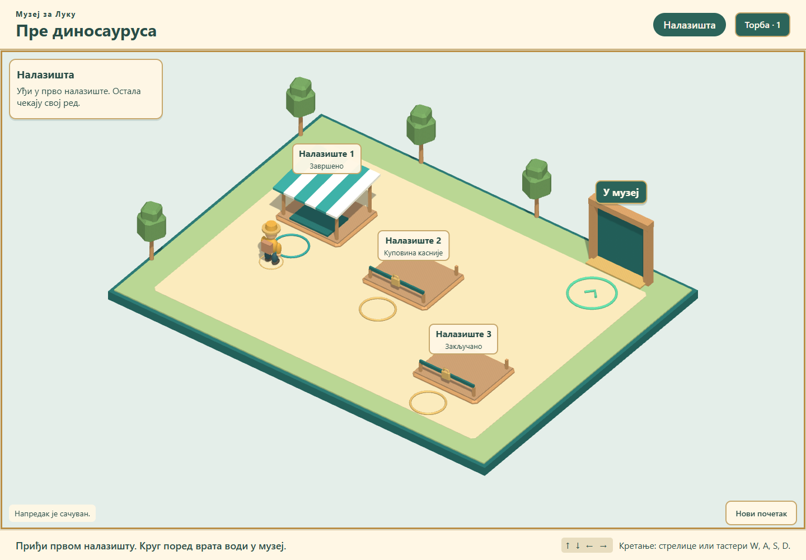
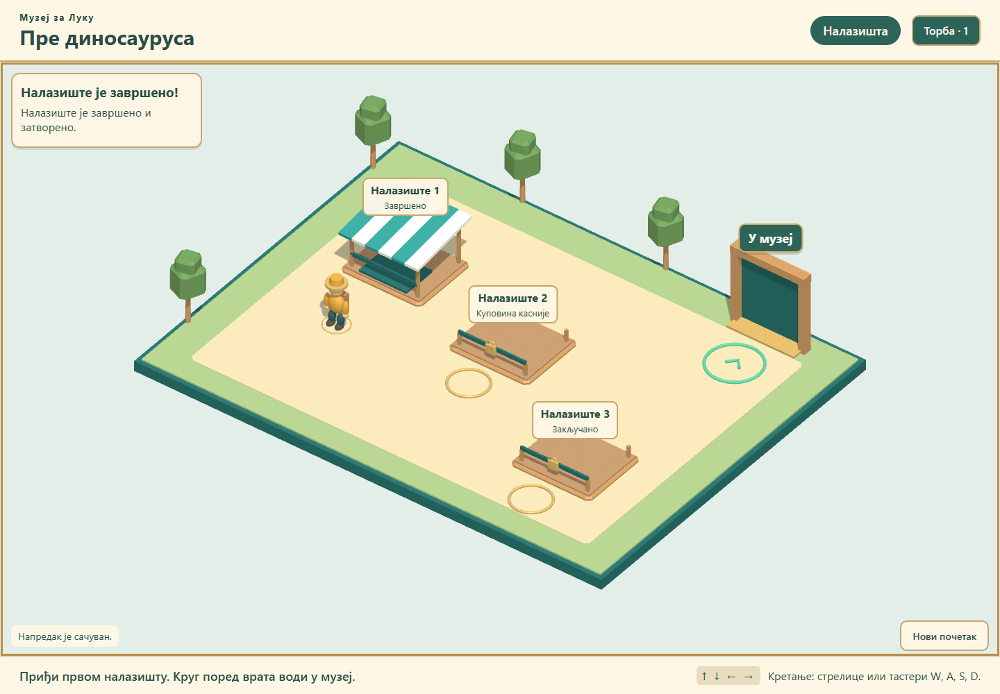

# Site-completion QA — 2026-10-07

## Results

- `npm test`: **29/29 pass**, including the six new completion tests and adjusted shovel/migration assertions.
- `npm run build`: **pass**. The existing Vite large-chunk advisory remains; no dependencies or bundling changes were introduced.
- `scripts/check-journey.mjs`: **pass**. Real keyboard excavation, automatic discovery popup, partial cleaning/reload, collection failure/retry, automatic success-card dismissal, paced cleanup with movement locked, reload during cleanup, automatic return, closure and blocked re-entry, progression, bag, museum return, confirmed/cancelled reset, corrupt saves and storage denial/recovery. No page/console errors.
- `scripts/check-completion.mjs`: **pass**. Per-frame evidence confirms one animated tile at a time, one removal per update, and visibly separated removals. Covers partially dug remaining tiles, hidden-page pause, cleanup reload, already-empty but uncleaned pits, real cleaning followed by the automatic ladder walk, reload during the outdoor exit stage, unique/durable closure, and the rail appearing only at the final front position.
- `scripts/check-browser.mjs`: **pass**. Existing movement, blur, pit circuit/collision/depth, room transitions, safe arrivals, and responsive labels remain correct. No page/console errors.

Commands used:

```text
npm test
npm run build
node scripts/check-journey.mjs F:/Milos/Repos/Muzej/node_modules/playwright/index.mjs http://127.0.0.1:5183/
node scripts/check-completion.mjs F:/Milos/Repos/Muzej/node_modules/playwright/index.mjs http://127.0.0.1:5183/
node scripts/check-browser.mjs F:/Milos/Repos/Muzej/node_modules/playwright/index.mjs http://127.0.0.1:5183/ docs/qa/completion-navigation
```

Browser: **Edge 154.0.4258.53**, isolated headless Playwright profiles. Main visual review at **1440 × 1000**; navigation/cleaning responsive checks also at **1280 × 720, 768 × 1024, 390 × 844**. Existing adjacent Playwright installation was used read-only. Luka's real browser/save was not accessed.

## Before and after

The prior completed site retained an active entrance ring and was enterable. The new closure occurs only after the character reaches the front, removes that ring, and displays the matching field rail.

| Previous completed site | Closed site after automatic return |
| --- | --- |
|  |  |

Additional reviewed evidence:

- [Cleanup in progress](completion-cleanup.png).
- [One tile popping, with other tiles still present](completion-pop.png).
- [Character emerging at the entrance before closure](completion-before-closure.png): ring still visible, site 2 still locked.
- [Final front position and closure](completion-front-closed.png): site 2 eligible, site 3 still locked.

The visible-sequence assertions use per-frame scene samples; screenshots alone do not prove the animation's timing. Screenshots were visually inspected as well. This is not a claim of a hands-on Luka playtest.

## Files and remaining review

See the [implementation and changed-file list](../site-completion.md). The game still has one authored fossil/site; the all-assigned-fossils gate has a separate two-find fixture. No completion currency/reward system exists in this slice, so the sequence does not introduce or duplicate rewards; exactly-once collection and next-site eligibility were verified.

Human QA: use a separate save, clean the find, and let the sequence finish without clicking a finish button. Confirm that individual pops and the automatic walk are understandable. At 0.45 seconds per remaining tile, a nearly untouched pit can take roughly 28 seconds to clear; the pacing remains a playtest tuning choice.
